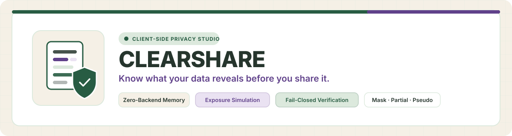
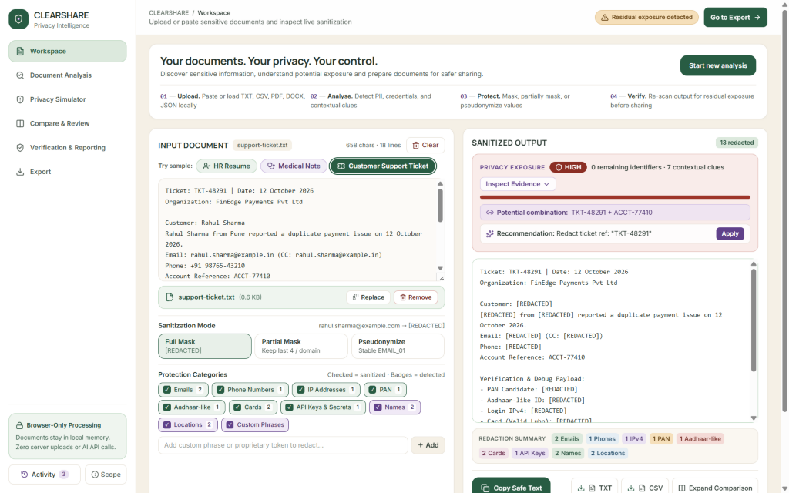
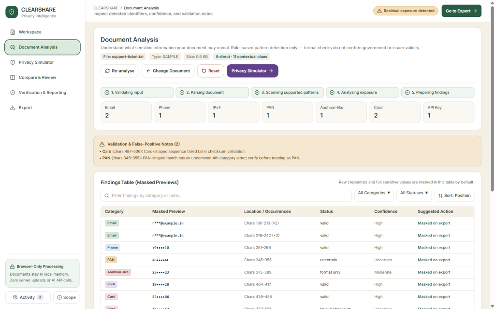
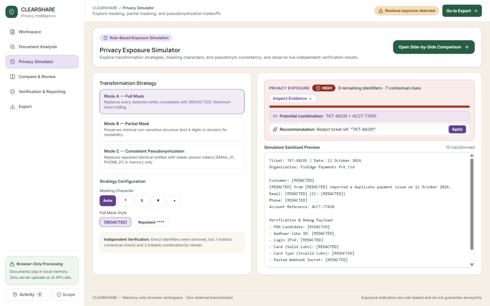
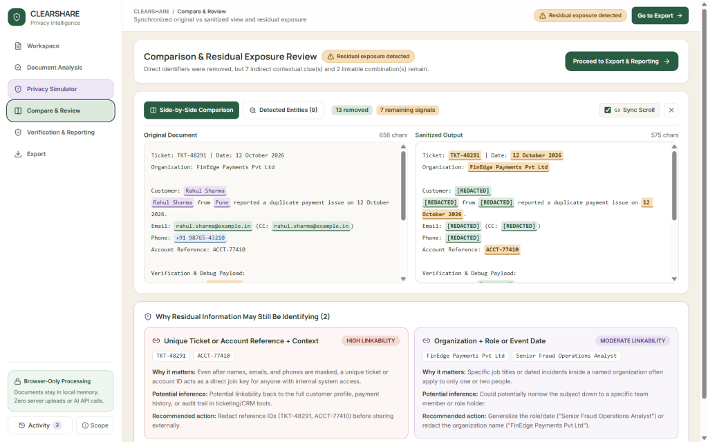
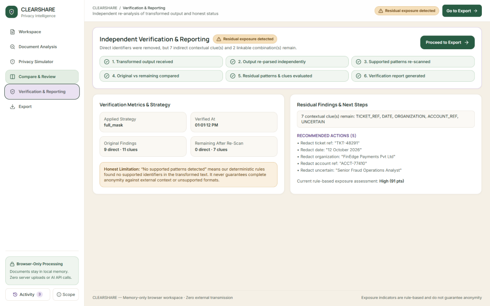
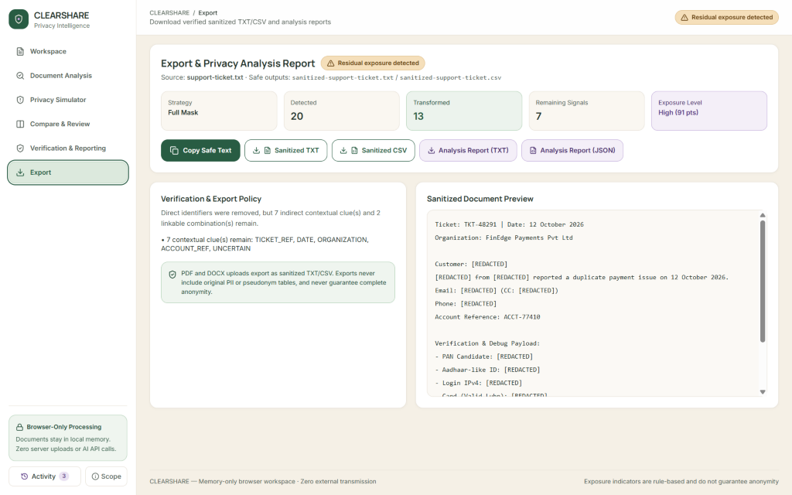
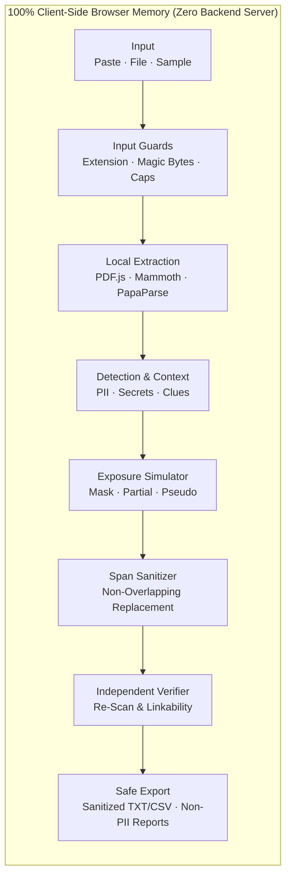

<p align="center">
  
</p>

<p align="center">
  <strong>Privacy Intelligence &amp; Document Exposure Simulation Platform</strong>
  <br />
  <sub>100% Client-Side Browser Processing &bull; Zero Backend Data Transmission &bull; Independent Fail-Closed Verification</sub>
</p>

<p align="center">
  <a href="https://github.com/sakshampete91-jpg/clearshare/actions/workflows/ci.yml"></a>
  
  
  
  
  
  
</p>

<p align="center">
  <a href="#-project-overview">Overview</a> &bull;
  <a href="#-application-screenshots">Screenshots</a> &bull;
  <a href="#-core-features">Features</a> &bull;
  <a href="#-system-architecture">Architecture</a> &bull;
  <a href="#-repository-structure">Structure</a> &bull;
  <a href="#-installation--local-development">Quick Start</a> &bull;
  <a href="#-security--privacy">Security</a> &bull;
  <a href="#-testing--quality-checks">Testing</a>
</p>

---

## Project Overview

Organizations and developers routinely share support tickets, resumes, medical notes, logs, and CSV exports without realizing what direct secrets or indirect contextual signals remain exposed.

**CLEARSHARE** (**"Know what your data reveals before you share it."**) is a client-side privacy intelligence workspace built for **PromptWars 2026** that answers three critical questions in real time:

1. **What sensitive information was detected?** (Direct identifiers, credentials/API keys, and heuristic contextual clues)
2. **How will sanitization transform it?** (Full Masking, Partial Masking, or session-scoped Consistent Pseudonymization)
3. **What privacy risk remains afterward?** (Independent re-scan, linkability explanation, and actionable recommendations)

Every stage executes **exclusively in browser memory** with zero server upload, zero `localStorage`/`sessionStorage` persistence, and strict fail-closed verification.

---

## Application Screenshots

All screenshots below were captured directly from the running CLEARSHARE web application using built-in synthetic sample data (`support-ticket.txt`).

<table>
  <tr>
    <td width="50%" valign="top">
      <a href="docs/screenshots/workspace.png">
        
      </a>
      <p align="center"><strong>1. Privacy Workspace</strong><br /><sub>Live input editor, built-in synthetic samples, category rules, and real-time sanitized preview.</sub></p>
    </td>
    <td width="50%" valign="top">
      <a href="docs/screenshots/document-analysis.png">
        
      </a>
      <p align="center"><strong>2. Document Analysis</strong><br /><sub>Masked diagnostics table, Luhn/PAN validation notes, custom regex rules, and highlighted text viewer.</sub></p>
    </td>
  </tr>
  <tr>
    <td width="50%" valign="top">
      <a href="docs/screenshots/privacy-simulator.png">
        
      </a>
      <p align="center"><strong>3. Privacy Exposure Simulator</strong><br /><sub>Full Mask / Partial Mask / Consistent Pseudonymization strategies, exposure meter, and one-click recommendations.</sub></p>
    </td>
    <td width="50%" valign="top">
      <a href="docs/screenshots/comparison.png">
        
      </a>
      <p align="center"><strong>4. Compare &amp; Review</strong><br /><sub>Synchronized original vs. sanitized comparison highlighting residual contextual linkability combinations.</sub></p>
    </td>
  </tr>
  <tr>
    <td width="50%" valign="top">
      <a href="docs/screenshots/verification.png">
        
      </a>
      <p align="center"><strong>5. Verification &amp; Reporting</strong><br /><sub>Independent 6-step re-scan pipeline reporting verified clean vs. residual exposure status and honest limitations.</sub></p>
    </td>
    <td width="50%" valign="top">
      <a href="docs/screenshots/export.png">
        
      </a>
      <p align="center"><strong>6. Safe Export</strong><br /><sub>Sanitized TXT, CSV formula-injection neutralized exports, and non-PII TXT/JSON privacy analysis reports.</sub></p>
    </td>
  </tr>
</table>

---

## Core Features

- **Multi-Format Client Extraction (`TXT`, `CSV`, `JSON`, `PDF`, `DOCX`)**
  - Validates magic bytes (`%PDF-`, `PK` ZIP container), file extensions, size limits (`5 MB` binary / `2 MB` text), `50`-page PDF cap, and `500,000`-character processing budget.
  - Parses PDFs (`pdfjs-dist` with local bundled worker), Word documents (`mammoth`), and CSV spreadsheets (`papaparse`).
- **Direct Identifier & Secret Detection Engine**
  - **PII:** Email addresses, Indian phone numbers (`+91` / `91` / `10`-digit prefixes), validated IPv4 (`0–255`), PAN format notes, Aadhaar-like `12`-digit numbers, Luhn-validated payment cards, plus default contextual Name & Location rules.
  - **API Keys & Secrets:** Bounded client-side detection for OpenAI-style keys (`sk-...`), AWS Access Key IDs (`AKIA...`), GitHub PATs (`ghp_...`), Google API keys (`AIza...`), Slack tokens (`xoxb-`), Stripe live keys (`sk_live_`), Bearer tokens, and high-confidence `api_key=` / `secret=` / `access_token=` assignments.
  - **Masked Diagnostics:** Secrets appear only as redacted previews (`[SECRET ••••xxxx]`) in the UI, diagnostics, and logs.
  - **Custom Detection Rules:** User-defined literal and ReDoS-guarded regex patterns (`validateCustomRegexPattern`).
- **Rule-Based Privacy Exposure Simulator**
  - Evaluates indirect contextual clues (`ORGANIZATION`, `DATE`, `TICKET_REF`, `ACCOUNT_REF`, `UNCERTAIN`) and multi-clue **linkability combinations** after direct identifiers are masked.
  - Lets users compare **Full Mask**, **Partial Mask**, and **Consistent Pseudonymization** (`EMAIL_01`, `PHONE_01`) with customizable mask glyphs (`Auto`, `*`, `X`, `#`, `•`).
- **Independent Verification & Fail-Closed Status**
  - Automatically re-parses and re-scans sanitized output independently before marking a document `Verified clean` or `Residual exposure detected`.
- **Hardened Browser & Export Controls**
  - Escaped React node rendering (zero `dangerouslySetInnerHTML`, `innerHTML`, `eval`, or `Function`).
  - CSV formula-injection neutralization (`neutralizeCsvFormulaCell` prefixes leading `=`, `+`, `-`, `@`, `\t`, `\r` with `'`).
  - Non-PII activity log and non-PII TXT/JSON privacy analysis reports.

---

## System Architecture

CLEARSHARE runs its entire privacy intelligence pipeline inside the browser, keeping sensitive documents off external networks. Detailed engineering notes live in [`docs/ARCHITECTURE.md`](docs/ARCHITECTURE.md) and [`backend/README.md`](backend/README.md).



---

## Tech Stack

| Layer | Technology | Purpose |
|---|---|---|
| **UI Framework** | React 19, TypeScript 7 | Strict typed component architecture & accessible state workflows |
| **Build & Bundling** | Vite 8, Web Workers | Fast local dev/build & off-thread processing for large documents |
| **Styling & Typography** | Tailwind CSS v4, `@fontsource/inter`, `@fontsource/manrope`, `lucide-react` | Bundled editorial typography & Cream / Forest Green / Royal Purple tokens |
| **Document Parsers** | `pdfjs-dist`, `mammoth`, `papaparse` | Local PDF, DOCX, and RFC-compliant CSV extraction |
| **Testing & Linting** | Vitest 5, Testing Library (`jsdom`), `oxlint` | Unit, integration, security regression, and UI workflow verification |
| **Static Delivery** | Docker (multi-stage Node + Nginx) | Hardened CSP & static header deployment (`Dockerfile`, `nginx.conf`) |

---

## Repository Structure

```text
clearshare/
├── .github/
│   ├── dependabot.yml                  # Weekly npm (frontend/) and GitHub Actions updates
│   └── workflows/
│       ├── ci.yml                      # Lint, typecheck, tests, build, audit & secret hygiene
│       ├── codeql.yml                  # CodeQL JavaScript/TypeScript static security analysis
│       └── dependency-review.yml       # Pull request dependency vulnerability review
├── backend/
│   └── README.md                       # Documents intentional zero-backend browser-only design
├── docs/
│   ├── assets/
│   │   └── clearshare-banner.svg       # Project brand SVG banner
│   ├── screenshots/                    # Verified 1440x900 UI screenshots (synthetic data)
│   │   ├── workspace.png
│   │   ├── document-analysis.png
│   │   ├── privacy-simulator.png
│   │   ├── comparison.png
│   │   ├── verification.png
│   │   └── export.png
│   ├── ARCHITECTURE.md                 # End-to-end processing pipeline & module layout
│   ├── SECURITY.md                     # Threat model, trust boundaries & known limitations
│   └── TESTING.md                      # Test suites, coverage summary & fixtures
├── frontend/                           # React + TypeScript + Vite web application
│   ├── public/
│   │   ├── assets/                     # Static public asset directory
│   │   └── favicon.svg
│   ├── src/
│   │   ├── app/                        # Session state & Web Worker orchestration
│   │   ├── components/                 # HighlightedViewer, Comparison, Simulator, Layout, UI
│   │   ├── data/                       # Built-in synthetic privacy sample fixtures
│   │   ├── engines/                    # Detection, Context Clues, Redaction, Simulation, Export
│   │   ├── features/                   # FindingsTable, UploadDropZone, OutputPanel
│   │   ├── pages/                      # All 6 primary screens
│   │   ├── security/                   # ReDoS guard, CSV formula guard, Web Crypto IDs
│   │   ├── services/                   # Pipeline orchestrator, Sanitizer, Verification, Reports
│   │   ├── styles/                     # Tailwind v4 tokens (`tokens.css`)
│   │   ├── types/                      # Shared TypeScript domain interfaces
│   │   ├── utils/                      # Category metadata & safe secret formatting
│   │   └── workers/                    # Background document processing Web Worker
│   ├── tests/                          # 7 Vitest suites covering 30 automated checks
│   ├── .env.example                    # Non-secret Vite environment variable template
│   ├── index.html                      # CSP meta header & app root
│   ├── package.json
│   ├── tsconfig.json
│   └── vite.config.ts
├── .dockerignore
├── .gitignore
├── Dockerfile                          # Multi-stage build serving frontend/dist via Nginx
├── nginx.conf                          # Strict CSP, HSTS, X-Frame-Options: DENY headers
└── README.md
```

---

## Installation & Local Development

### Prerequisites

- **Node.js** `20+` or `22+` (`node -v`)
- **npm** (`npm -v`; on Windows PowerShell with restricted `.ps1` execution policies, use `npm.cmd`)

### 1. Run Frontend Locally

```bash
git clone https://github.com/sakshampete91-jpg/clearshare.git
cd clearshare/frontend
npm install
npm run dev
```

Open **`http://localhost:5173/`** in your browser and click **`Customer Support Ticket`**, **`HR Resume`**, or **`Medical Note`** to run an immediate end-to-end exposure simulation with built-in synthetic data.

### 2. Build & Preview Production Bundle

```bash
cd frontend
npm run build
npm run preview
```

### 3. Optional Static Container Build (Nginx)

```bash
docker build -t clearshare .
docker run --rm -p 8080:8080 clearshare
```

---

## Security & Privacy

CLEARSHARE is designed around strict client-side trust boundaries:

- **Zero document transmission:** No backend document API, no telemetry calls, and locally bundled `@fontsource` fonts + `pdfjs-dist` worker.
- **Zero browser storage of sensitive content:** Verified by CI checks rejecting `localStorage`, `sessionStorage`, `dangerouslySetInnerHTML`, `innerHTML`, `XMLHttpRequest`, and `Math.random()` inside `frontend/src/`.
- **Defense against unsafe inputs:** File magic-byte validation, bounded custom regex execution (`ReDoS` prevention), CSV formula neutralization, and masked diagnostic previews.
- **Automated repository security checks:** GitHub Actions runs CI secret hygiene (`npm audit`, `.env`/credential pattern rejection) alongside CodeQL and Pull Request Dependency Review.

Read the full threat model and known limitations in [`docs/SECURITY.md`](docs/SECURITY.md).

---

## Testing & Quality Checks

Run all verification checks from the `frontend/` workspace:

```bash
cd frontend

# Static linter (oxlint)
npm run lint

# Strict TypeScript check
npm run typecheck

# Full automated test suite (7 test files, 30 tests)
npm run test:run

# Production bundle build
npm run build
```

See [`docs/TESTING.md`](docs/TESTING.md) for suite-by-suite coverage details across detection, redaction, exposure simulation, CSV/PDF/DOCX extraction, ReDoS prevention, formula neutralization, and UI workflows.

---

## Demo & Walkthrough

A self-contained interactive demo is built directly into the application:

1. Start the local app (`cd frontend && npm run dev`) and visit `http://localhost:5173/`.
2. Select **`Customer Support Ticket`** in the **Workspace** panel to inspect how CLEARSHARE detects PII + API keys, masks direct identifiers, and exposes remaining contextual linkability (`TKT-48291` + `ACCT-77410`).
3. Switch strategies inside **Privacy Simulator** (`Full Mask`, `Partial Mask`, `Consistent Pseudonymization`) and click **`Apply`** on contextual recommendations to watch **Independent Verification** transition to clean status.

---

## Project Status & Contributing

CLEARSHARE is maintained as a production-grade hackathon release for **PromptWars 2026**.

To contribute improvements:
1. Fork the repository and create a feature branch from `main`.
2. Ensure `npm run lint`, `npm run typecheck`, `npm run test:run`, and `npm run build` pass inside `frontend/`.
3. Never commit `.env` files, build artifacts, or real PII/credentials — use synthetic test fixtures constructed safely at runtime.

---

<p align="center">
  <sub>Built for privacy-conscious document sharing &bull; <strong>CLEARSHARE</strong> — <em>Know what your data reveals before you share it.</em></sub>
</p>
